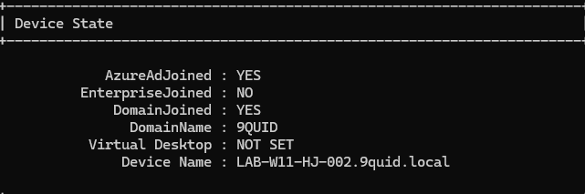
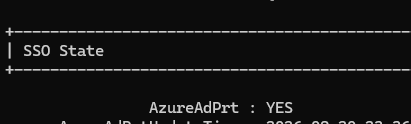
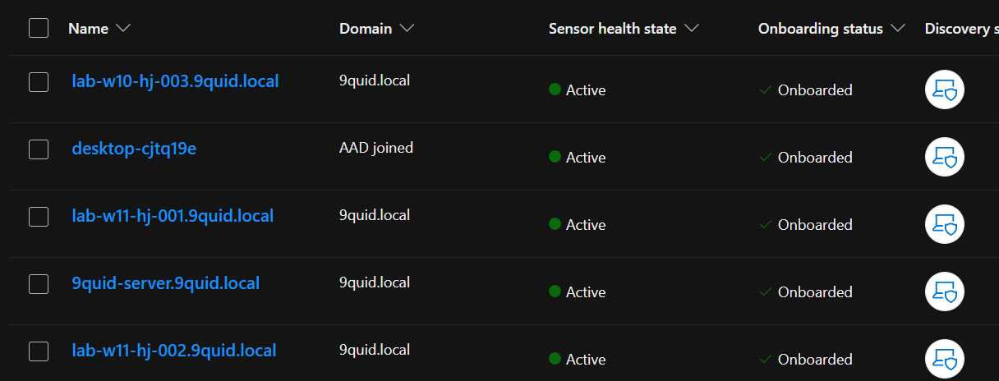
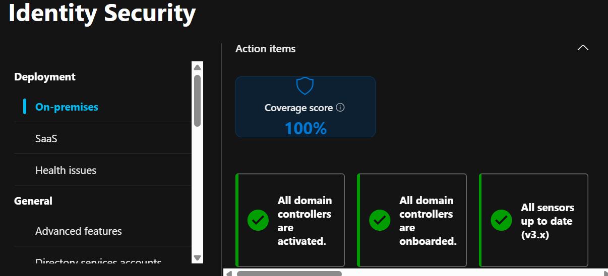
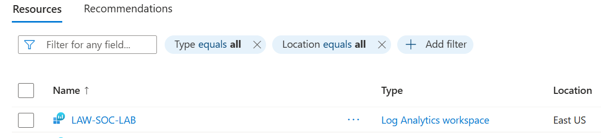
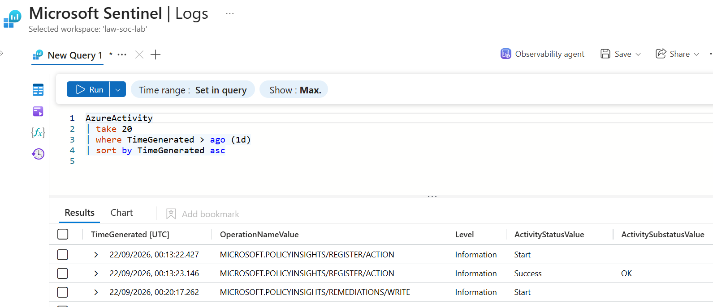
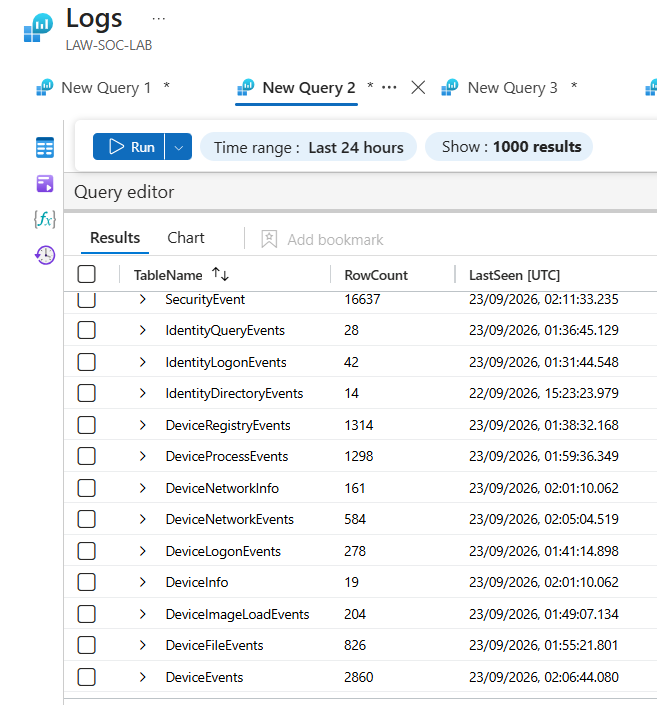

# Environment validation
 
Before building detections or running attack simulations, I wanted to confirm that the lab was in a healthy, known-good state.
 
This gave me a baseline to work from. If something stopped working later, I could compare it against these results instead of guessing whether the problem came from Active Directory, hybrid join, Group Policy, Defender XDR, or Sentinel.
 
The goal was not to capture every configuration screen. It was to prove that the core identity, endpoint, and monitoring components were working together before relying on them during an investigation.
 
---
 
## Domain controller
 
I started by checking the health of the domain controller, its core services, DNS resolution, and domain discovery.
 
```powershell
dcdiag /v
Get-Service Netlogon
nltest /dsgetdc:9quid.local
Resolve-DnsName 9QUID-SERVER.9quid.local
```
 
### Expected result
 
- The relevant `dcdiag` tests complete without critical failures.
- The Netlogon service is running.
- The domain controller can be discovered for `9quid.local`.
- The domain controller hostname resolves to the expected IP address.
- DNS does not return unexpected or stale records for the domain controller.
 
This was especially important after the accidental domain controller rename. A successful sign-in alone would not have been enough to prove that DNS, domain discovery, and the underlying Active Directory services had recovered correctly.
 
---
 
## Hybrid-joined client
 
I validated the client locally using:
 
```powershell
dsregcmd /status
```
 
### Expected result
 
Under **Device State**:
 
```text
AzureAdJoined : YES
DomainJoined : YES
```
 
Under **SSO State**:
 
```text
AzureAdPrt : YES
```
 
These values confirm that the device remains joined to the on-premises Active Directory domain, is registered with Microsoft Entra ID, and has obtained a Primary Refresh Token for cloud authentication.
 
This was the main success condition for the hybrid-join setup. The device needed to exist in both environments rather than being only domain joined or only Entra joined.
 
---
 
## Group Policy and MDM enrollment
 
I used the following commands to confirm that the client had received the expected computer policy and MDM enrollment configuration:
 
```powershell
gpresult /scope computer /h report.html
 
Get-ItemProperty `
"HKLM:\SOFTWARE\Policies\Microsoft\Windows\CurrentVersion\MDM"
```
 
### Expected result
 
- The generated Group Policy report lists the MDM enrollment policy as applied.
- The MDM policy registry path is present.
- `AutoEnrollMDM` is configured with the expected value.
 
This check became useful when I initially suspected a Group Policy problem but later found that Conditional Access was influencing the enrollment process.
 
It reinforced the importance of validating each layer separately instead of assuming that the first visible symptom identifies the actual cause.
 
---
 
## Defender XDR
 
On the client, I checked the Microsoft Defender for Endpoint service:
 
```powershell
sc.exe query sense
```
 
### Expected result
 
The `Sense` service is present and running.
 
I then verified the device in the Microsoft Defender portal:
 
```text
security.microsoft.com
→ Assets
→ Devices
```
 
The device should show:
 
- Onboarding status: `Onboarded`
- A recent **Last seen** value
- The expected device name and operating system
- Available device telemetry
 
This confirmed more than the presence of the local service. It proved that the endpoint was successfully communicating with Defender XDR and could be used for later investigation and hunting exercises.
 
---
 
## Microsoft Sentinel
 
The final validation step was to confirm that Defender telemetry was available through the Microsoft Sentinel workspace.
 
```kusto
DeviceLogonEvents
| take 20
```
 
I ran this query from the Sentinel-connected environment rather than relying only on Defender Advanced Hunting.
 
### Expected result
 
The query returns recent device logon activity from an onboarded lab endpoint.
 
This distinction mattered because Defender XDR having telemetry does not automatically prove that the Sentinel integration is working as intended.
 
I wanted to validate the complete path:
 
```text
Lab endpoint
→ Defender for Endpoint
→ Defender XDR
→ Microsoft Sentinel
→ KQL investigation
```
 
A successful query gave me confidence that the environment was ready for custom detections, incident generation, and investigation work.
 
---
 
## Validation summary
 
At the end of validation, I confirmed that:
 
- The domain controller was healthy and discoverable.
- DNS resolved the domain controller correctly.
- The client was joined to both Active Directory and Microsoft Entra ID.
- The client had obtained a Primary Refresh Token.
- The expected computer policy had been applied.
- The Defender for Endpoint service was running.
- The endpoint appeared as onboarded in Defender XDR.
- Device telemetry could be queried through the Sentinel-connected environment.
 
With that baseline established, I could begin attack simulations and investigations knowing that missing telemetry was less likely to be caused by an incomplete lab build.
 
---
 
## Evidence
 
I kept the screenshots limited to the results that prove the environment reached the expected end state.
 
### Hybrid join validation
 
Output from `dsregcmd /status` showing:
 
```text
AzureAdJoined : YES
DomainJoined : YES
AzureAdPrt : YES
```
 

 
### Defender XDR onboarding
 
The lab endpoint listed in the Microsoft Defender portal with an onboarding status of `Onboarded` and a recent **Last seen** value.
 


## Defender for Identity

After activation, I confirmed the domain controller appeared in the Defender portal and that the sensor was reporting successfully.

### Expected Result

- Sensor status: `Running`
- Domain controller visible
- Identity telemetry available

### Verification

```text
security.microsoft.com
→ Identities
→ Sensors
```

### Evidence



The screenshot shows the domain controller reporting with a healthy sensor status.
 
## Log Analytics Workspace

The Log Analytics Workspace serves as the central data repository for Microsoft Sentinel.

### Expected Result

- Workspace successfully created
- Workspace accessible from Azure
- Data ingestion available
- Connected data sources can write events into the workspace

### Verification

I confirmed the workspace existed and was available for Sentinel deployment.

```text
Azure Portal
→ Log Analytics Workspaces
→ LAW-SOC-LAB
```

### Evidence



The screenshot shows the Log Analytics Workspace created successfully and available for use.

---

## Microsoft Sentinel

The next validation step was confirming that Microsoft Sentinel could access and query telemetry from connected data sources.

### Expected Result

Recent events should be returned from Defender XDR data tables.

### Verification

```kusto
DeviceLogonEvents
| take 20
```

### Result

The query returned recent authentication events from onboarded lab devices.

This confirmed that the telemetry path was functioning correctly:

```text
Lab Endpoint → Defender for Endpoint → Defender XDR → Microsoft Sentinel
```

### Evidence

`screenshots/sentinel-device-logon-events.png`

The screenshot shows endpoint telemetry successfully returned through Sentinel.

---

## Azure Activity Logs

Azure Activity logging was configured to stream subscription activity into the Log Analytics Workspace.

### Expected Result

Recent Azure administrative activity should be available for investigation and hunting inside Sentinel.

### Verification

```kusto
AzureActivity
| take 20
```

### Result

The query returned Azure Activity events from the subscription.

This confirmed that the following path was functioning correctly:

```text
Azure Subscription → Azure Activity Logs → Log Analytics Workspace → Microsoft Sentinel
```

### Evidence



The screenshot shows Azure Activity events successfully ingested into the workspace and available through Sentinel.

---

### Environment Readiness

To make sure the environment was genuinely ready for investigations, I queried all major telemetry sources and verified that they were returning live data rather than simply showing a Connected status.

The query returned telemetry from:

- Windows endpoints
- Active Directory identity sources
- Microsoft Entra ID
- Azure Activity

Key validated tables included:

- `DeviceProcessEvents`
- `DeviceLogonEvents`
- `DeviceNetworkEvents`
- `IdentityLogonEvents`
- `IdentityQueryEvents`
- `SigninLogs`
- `AzureActivity`

### Evidence



The screenshot shows multiple telemetry tables returning live data with recent timestamps.

This confirms that endpoint, identity, cloud identity, and Azure management telemetry are flowing into the Log Analytics Workspace and are available for investigation through Microsoft Sentinel.

With these checks completed, the environment was considered ready for:

- Detection engineering
- Threat hunting
- Attack simulation
- Incident investigation
- Automation and case management