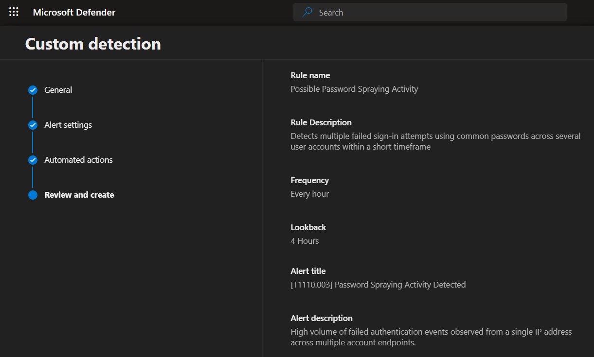
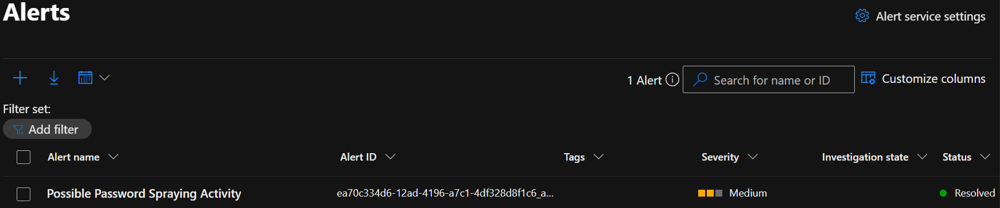

# Password Spray Investigation

## Case Details

| Field | Value |
|---|---|
| Date | 2026-09-23 |
| Detection Platform | Microsoft Defender XDR |
| Detection Rule | Possible Password Spraying Activity |
| MITRE ATT&CK | T1110.003, Password Spraying |
| Severity | Medium |
| Affected Department | Finance |
| Current Verdict | Benign Positive, Authorized Security Test |

---

## Executive Summary

On 23 September 2026, four Finance department accounts recorded failed NTLM authentication attempts from the same source IP, `192.168.1.50`, at 17:24:46 UTC.

The affected accounts were Henry Ross, Lydia Morgan, Martin Cooper, and Ava Bennett. Each authentication event had an action type of `LogonFailed` and a failure reason of `WrongPassword`.

The observed pattern was consistent with password spraying because a single source attempted authentication against multiple accounts within the same activity window.

No successful authentication was identified during the investigation window.

The activity matched MITRE ATT&CK technique **T1110.003, Password Spraying** under the **Credential Access** tactic and successfully triggered the custom detection rule.

Because the activity was intentionally generated as part of an authorized lab exercise, the final classification was **Benign Positive**.

---

## Detection

### Detection Logic

The custom detection identifies:

**One Source IP → Multiple Accounts → Authentication Failures → Short Time Window**

This behavior is characteristic of password spraying and differs from traditional brute-force attacks that repeatedly target a single account.

### Platform Evidence

- 
- 
---

# Investigation

 
## Raw Authentication Events
 
The underlying authentication telemetry was reviewed directly rather than relying only on the alert summary.
 
| Timestamp in UTC | Account | Source IP | Result | Protocol | Failure Reason |
|---|---|---|---|---|---|
| 2026-09-23 17:24:46 | `henry.ross@9quidsecurity.com` | `192.168.1.50` | `LogonFailed` | NTLM | `WrongPassword` |
| 2026-09-23 17:24:46 | `lydia.morgan@9quidsecurity.com` | `192.168.1.50` | `LogonFailed` | NTLM | `WrongPassword` |
| 2026-09-23 17:24:46 | `martin.cooper@9quidsecurity.com` | `192.168.1.50` | `LogonFailed` | NTLM | `WrongPassword` |
| 2026-09-23 17:24:46 | `ava.bennett@9quidsecurity.com` | `192.168.1.50` | `LogonFailed` | NTLM | `WrongPassword` |

 
**Query:** `queries/01-raw-event-validation.kql`

 
---
 
## Password Spray Pattern
 
The authentication events were grouped by source IP to measure the number of failed attempts and distinct targeted accounts.
 
| Source IP | Targeted Accounts | Failed Attempts | Protocol | Destination |
|---|---:|---:|---|---|
| `192.168.1.50` | 4 | 4 | NTLM | `9quid-server.9quid.local` |

 
The activity met the configured detection threshold of four distinct accounts from a common source.

 
**Query:** `queries/02-pattern-validation.kql`

 
---
 
## Targeted Accounts
 
| Account | Department | Authentication Result |
|---|---|---|
| `henry.ross@9quidsecurity.com` | Finance | Failed |
| `lydia.morgan@9quidsecurity.com` | Finance | Failed |
| `martin.cooper@9quidsecurity.com` | Finance | Failed |
| `ava.bennett@9quidsecurity.com` | Finance | Failed |

 
All four accounts were targeted during the same execution window.

 
---
 
## Scope
 
| Attribute | Observed Value |
|---|---|
| Source IP addresses | 1 |
| Source IP | `192.168.1.50` |
| Targeted accounts | 4 |
| Targeted department | Finance |
| Destination host | `9quid-server.9quid.local` |
| Authentication protocol | NTLM |
| Authentication result | `LogonFailed` |
| Failure reason | `WrongPassword` |
| Successful compromise | No |
| Defender XDR alerts generated | 4 |

 
**Query:** `queries/03-scope.kql`

 
---
 
## Timeline
 
| Time in UTC | Event |
|---|---|
| 17:24:46 | Failed NTLM authentication against Henry Ross |
| 17:24:46 | Failed NTLM authentication against Lydia Morgan |
| 17:24:46 | Failed NTLM authentication against Martin Cooper |
| 17:24:46 | Failed NTLM authentication against Ava Bennett |
| After rule evaluation | Microsoft Defender XDR custom detection generated four alerts |
| After alert generation | Alert entities and underlying authentication telemetry were reviewed |
| After final validation | Case classified as a Benign Positive and closed |

 
**Query:** `queries/04-timeline.kql`

 
---
 
## Successful Authentication Review
 
Authentication activity for all four targeted accounts was reviewed to determine whether any account authenticated successfully after the failures.
 
| Account | Spray Result | Successful Authentication Associated With Spray |
|---|---|---|
| `henry.ross@9quidsecurity.com` | Failed | No |
| `lydia.morgan@9quidsecurity.com` | Failed | No |
| `martin.cooper@9quidsecurity.com` | Failed | No |
| `ava.bennett@9quidsecurity.com` | Failed | No |

 
No successful authentication associated with the observed password spray was identified during the investigation window.

 
**Query:** `queries/05-success-check.kql`

 
---
 
## Findings
 
### Finding 1: Four Finance Accounts Were Targeted
 
The activity affected four Finance department accounts within the same execution window.
 
### Finding 2: The Attempts Originated From One Source
 
All observed authentication failures originated from `192.168.1.50`.
 
The common source and timing indicate coordinated authentication activity rather than independent password mistakes.
 
### Finding 3: The Authentication Pattern Was Consistent
 
Every observed event recorded:
 
- `ActionType = LogonFailed`
- `Protocol = NTLM`
- `FailureReason = WrongPassword`
 
### Finding 4: The Activity Matched Password Spraying
 
The source attempted authentication against multiple accounts while keeping the number of attempts against each individual account low.
 
This horizontal targeting pattern is consistent with password spraying rather than traditional brute force against one account.
 
### Finding 5: The Spray Was Unsuccessful

 
No successful authentication associated with the password spray was identified during the investigation window.
 
No account compromise was established.

 
---

## Assessment
### Confirmed
- Four Finance department accounts were targeted.
- All observed attempts originated from `192.168.1.50`.
- NTLM authentication was used.
- All observed attempts failed.
- The failure reason was `WrongPassword`.
- The destination was the on-premises domain controller.
- The activity met the configured detection threshold.
- The Microsoft Defender XDR custom detection generated four alerts.
- No successful authentication associated with the spray was identified.
 
### Consistent With
 
The observed behavior is consistent with MITRE ATT&CK T1110.003, Password Spraying.

### Ruled Out

- Traditional brute force against a single account
- Successful authentication during the reviewed activity window

---

## Response

Because the activity was an authorized security test, no containment or remediation actions were required.

If the same activity occurred in production, recommended actions would include:

1. Review targeted accounts for successful authentication.
2. Confirm MFA coverage.
3. Investigate source IP activity.
4. Review privileged account exposure.
5. Escalate if successful authentication is observed.

---

## Verdict

### Classification

**Benign Positive**

### Reasoning

The observed activity accurately matched the characteristics of a password spray attack and was successfully detected by the custom detection logic.

However, the activity was intentionally generated as part of an authorized lab exercise and therefore posed no actual organizational risk.

No successful authentication was identified during the investigation window.

---

## Lessons Learned

1. Password spraying is identified through behavioral patterns across multiple accounts rather than a high number of failures against a single account.
2. Reviewing raw authentication telemetry is critical when validating detections.
3. Proper entity mapping significantly improves alert context and investigation quality.
4. Microsoft Defender XDR identity telemetry provides sufficient evidence to investigate password-spray activity without relying on Microsoft Entra ID sign-in logs.
5. Detection engineering and investigation should be documented separately to keep reports concise and focused.
