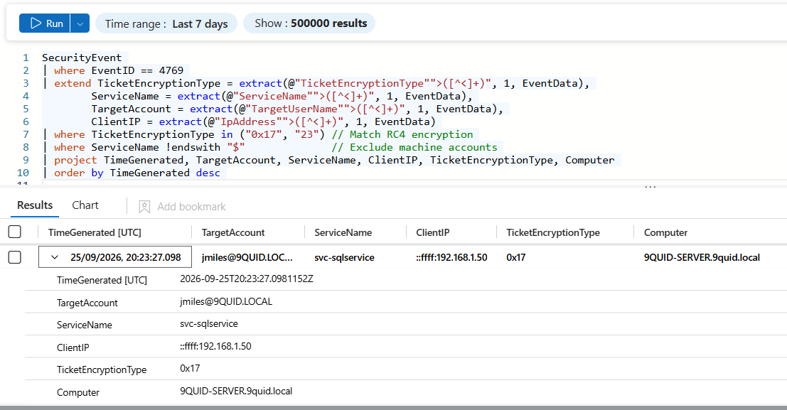
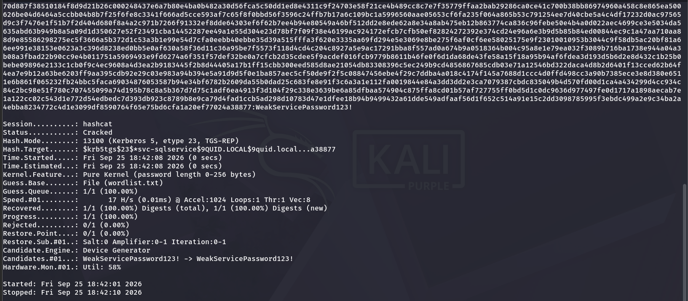
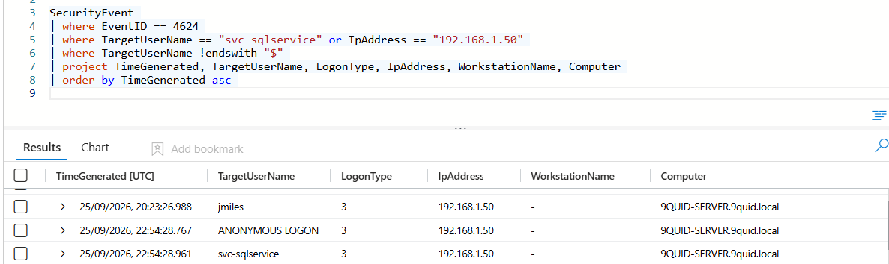
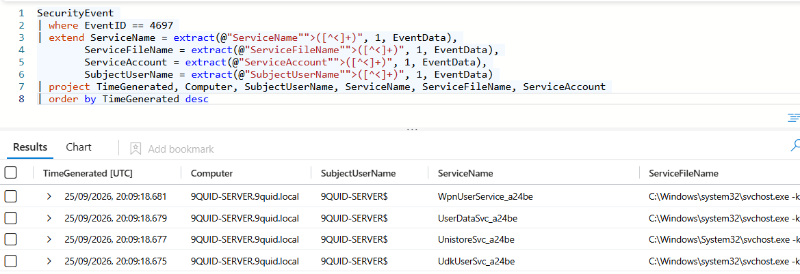

# Kerberoasting Investigation

## Case Details

| Field | Value |
|---|---|
| Date | September 25 to September 26, 2026 (UTC) |
| Detection Platform | Microsoft Defender for Identity and Microsoft Defender XDR |
| Incident | Credential theft and account discovery activity across multiple devices |
| Alerts Correlated | 5 |
| Severity | High |
| MITRE ATT&CK | T1558.003 Kerberoasting, T1087 Account Discovery, T1078 Valid Accounts |
| Affected Asset | `9QUID-SERVER` |
| Verdict | True Positive, Authorized Security Test |
| Incident ID | 9 |

---

## Executive Summary

An authorized security test successfully exposed the password of a service account used for SQL Server.

The account had a weak password that could be recovered from a Kerberos service ticket. Microsoft Defender detected the activity and grouped five related alerts into one incident.

The compromised password was reset, the original account was disabled, and the service was moved to a managed account with an automatically maintained password.

The detection was accurate, but the activity presented no organizational risk because it was performed intentionally inside an isolated lab.

## Technical Summary

A Kerberoasting attack was carried out against a deliberately created service account, `svc-sqlservice`, which held a registered Service Principal Name (`MSSQLSvc/sqlserver.9quid.local:1433`). An authenticated domain account (`jmiles`) was used to enumerate the SPN, and request a Kerberos service ticket for `svc-sqlservice`. The ticket was issued using RC4 encryption, extracted, and successfully cracked offline, recovering the account's plaintext password.

Microsoft Defender for Identity independently detected the activity across its full lifecycle — LDAP reconnaissance, the AS-REQ, SPN exposure, and the Kerberoasting attack itself — correlating all five resulting alerts into a single incident.

The recovered password was independently confirmed via direct SMB authentication. Post-exploitation logon activity using the compromised account was identified and scoped. One unrelated event (routine service installation activity) was reviewed and ruled out.

---

## Detection

### Incident Overview

Microsoft Defender XDR automatically correlated five related Defender for Identity alerts into a single incident (Incident ID 9), scored High severity. This differed from the Password Spray investigation, where a custom detection rule generated four separate alerts that were never grouped into an incident. The comparison shows that accurate detection is only one part of an effective security workflow — related alerts must also be connected so an analyst can review the full activity as one case, not several disconnected ones.

### Alerts Generated

1. Possible Kerberoasting LDAP reconnaissance — Sep 25, 2026 4:26:47 PM
2. Possible Kerberoasting attack — Sep 25, 2026 4:27:43 PM
3. Suspected Kerberos SPN exposure — Sep 25, 2026 4:28:21 PM
4. Suspicious Kerberos authentication (AS-REQ) — Sep 25, 2026 4:41:11 PM
5. Possible Kerberoasting following a suspicious LDAP query — Sep 25, 2026 4:42:20 PM

### Platform Evidence


---

## Investigation

### Kerberos Ticket Request

Windows Event ID 4769 confirmed that a service ticket was requested for `svc-sqlservice`.

| Field | Observed Value |
|---|---|
| Requesting account | `jmiles@9QUID.LOCAL` |
| Target service account | `svc-sqlservice` |
| Ticket encryption | `0x17` (RC4) |
| Ticket options | `0x40810010` |
| Source IP address | `192.168.1.50` |
| Request status | Successful |
| Domain controller encryption support | RC4, AES128, and AES256 |
| Service account keys | AES and RC4 |

### Detection Query

### Evidence 1 — Kerberos Service Ticket Request (4769)

```
SecurityEvent 
| where EventID == 4769 
| extend TicketEncryptionType = extract(@"TicketEncryptionType"">([^<]+)", 1, EventData), 
        ServiceName = extract(@"ServiceName"">([^<]+)", 1, EventData), 
        TargetAccount = extract(@"TargetUserName"">([^<]+)", 1, EventData), 
        ClientIP = extract(@"IpAddress"">([^<]+)", 1, EventData) 
| where TicketEncryptionType in ("0x17", "23") // Match RC4 encryption 
| where ServiceName !endswith "$"              // Exclude machine accounts 
| project TimeGenerated, TargetAccount, ServiceName, ClientIP, TicketEncryptionType, Computer 
| order by TimeGenerated desc
```

- 

### Analysis

The domain controller supported stronger AES encryption, but the ticket issued for svc-sqlservice used the older RC4 method.

This mattered because RC4-protected tickets are more practical to test against password guesses offline. The account's weak password then made the ticket vulnerable to cracking.

The problem was therefore not that the domain controller lacked modern encryption support. The risk came from the service account accepting RC4 and using a weak, manually managed password.

---

### Post-Exploitation Logons (Scoping Lateral Movement)

The captured service ticket was tested offline using Hashcat and the test successfully recovered the password configured for svc-sqlservice.



### Evidence 3 — Credential Validation

The recovered credentials were then tested against the domain controller.

SMB    192.168.1.9    445    9QUID-SERVER
[+] 9quid.local\svc-sqlservice:WeakServicePassword123!

This confirmed that:

The recovered password was correct.
The account credentials were still active.
The weakness was exploitable and not merely theoretical.

The offline recovery and the successful authentication provided two separate forms of evidence confirming that the service account credentials had been compromised.

### Evidence 4 - Tracking Service Account Logon Activity (Event 4624) in Sentinel

```
SecurityEvent 
| where EventID == 4624 
| where TargetUserName == "svc-sqlservice" or IpAddress == "192.168.1.50" 
| where TargetUserName !endswith "$" 
| project TimeGenerated, TargetUserName, LogonType, IpAddress, WorkstationName, Computer 
| order by TimeGenerated asc
```



Looking at the screenshot above, it can be confirmed that there was a successful logon(EventID=4624), for the compromised svc-sqlservice on 25/09/2026 at 22:54:28.961 UTC and 26/09/2026 at 00:35:27.567 UTC coming from IP address 192.168.1.50 with a logon type 3 which indicates network logon via SMB

### Evidence 5 - Analyzing Execution & Persistence

Next, I needed to verify if the attacker established persistence or executed a malicious payload by checking for Newly Installed Services (Event 4697)

```
SecurityEvent 
| where EventID == 4697 
| extend ServiceName = extract(@"ServiceName"">([^<]+)", 1, EventData), 
        ServiceFileName = extract(@"ServiceFileName"">([^<]+)", 1, EventData), 
        ServiceAccount = extract(@"ServiceAccount"">([^<]+)", 1, EventData), 
        SubjectUserName = extract(@"SubjectUserName"">([^<]+)", 1, EventData) 
| project TimeGenerated, Computer, SubjectUserName, ServiceName, ServiceFileName, ServiceAccount 
| order by TimeGenerated desc
```

- 

From the screenshot above, no suspicious running processes were found, just local system services running.


## Findings

### Confirmed

- `svc-sqlservice` had a registered SPN, making it a valid Kerberoasting target
- A Kerberos service ticket was successfully requested using standard, unprivileged domain credentials (`jmiles`)
- The ticket was issued with RC4 encryption even though AES keys were available; RC4 was intentionally left enabled for this lab scenario
- The ticket was successfully cracked offline, recovering the account's real password
- The recovered password was independently confirmed via direct SMB authentication
- The compromised account was used for at least two subsequent network logons from the same source
- Microsoft Defender for Identity detected and correctly correlated all five stages of the attack into one incident

### Activity Consistent With

- MITRE ATT&CK T1558.003, Kerberoasting
- MITRE ATT&CK T1087, Account Discovery (the LDAP reconnaissance stage)
- Realistic multi-account attacker behavior (T1078, Valid Accounts)

### Ruled Out

- Persistence via malicious service installation (Evidence 5 — all reviewed services resolved to legitimate, expected executables)

---

## Impact Assessment

**Confirmed:**

- Credential compromise (service account password recovered and validated)

**Not Confirmed:**

- Administrative access
- Lateral movement beyond the domain controller itself
- Privilege escalation
- Persistence

This distinction matters: the investigation proved a real, exploitable credential compromise, but found no evidence the attacker moved beyond that single compromised service account's own authentication activity.

---

## Response and Remediation

Because this was an authorized lab exercise, the following actions were performed and independently verified, not merely recommended.

### Immediate Containment

#### Password Reset

```powershell
Set-ADAccountPassword -Identity "svc-sqlservice" -Reset -NewPassword `
  (ConvertTo-SecureString "<redacted-new-password>" -AsPlainText -Force)
```

#### Verification

The exact same attack chain (SPN enumeration, ticket request, offline crack) was re-run against the account after the reset, using the attacker's original known wordlist:
```
Status...........: Exhausted
Recovered........: 0/1 (0.00%) Digests (total), 0/1 (0.00%) Digests (new)
Candidates.#01...: WeakServicePassword123! -> WeakServicePassword123!
```

This confirmed the original weak password was no longer valid. The new ticket still used RC4, however — the password reset fixed the immediate compromise but did not remove the older encryption method or the underlying need to manually manage the account's password.

### Long-Term Remediation

#### gMSA Migration

A Group Managed Service Account was created to replace `svc-sqlservice`. Its password is generated and maintained automatically by Active Directory — no administrator ever creates, stores, or manually rotates it. A valid KDS root key already existed in the domain, so no additional key setup was required.

```powershell
New-ADServiceAccount -Name "svc-sql-gmsa" `
  -DNSHostName "sqlserver.9quid.local" `
  -PrincipalsAllowedToRetrieveManagedPassword "LAB-W11-HJ-001$"

```

#### AES Enforcement

```powershell
Set-ADServiceAccount -Identity "svc-sql-gmsa" -KerberosEncryptionType AES256
```

#### Anonymous SMB Hardening

Addressing a related finding from earlier reconnaissance in this lab (`Null Auth: True` observed against this DC):

```powershell
Set-ItemProperty "HKLM:\SYSTEM\CurrentControlSet\Control\Lsa" -Name "RestrictAnonymous" -Value 1
```

### Production Note

This lab bound the gMSA to a single computer account for simplicity. In a real environment, `PrincipalsAllowedToRetrieveManagedPassword` should point at a security group instead, so adding a server that needs to run the service doesn't require reconfiguring the gMSA itself — only updating group membership.

---

## Verification

The managed account was checked after migration:
```
ServicePrincipalNames : MSSQLSvc/sqlserver.9quid.local:1433
Enabled               : True
ObjectClass           : msDS-GroupManagedServiceAccount
```
The SPN cleanly migrated with no overlap, the old account is disabled, and the service identity now uses AES-only encryption with an auto-rotating password no person ever sees.

---

## Final Verdict

**Detection Verdict:** True Positive
**Risk Classification:** Benign, Authorized Security Test

### Reasoning

The activity was a successful Kerberoasting attack — a service ticket was requested, the service account's password was recovered, and the recovered credentials were validated against the domain controller. Microsoft Defender detected the related activity and correctly grouped five alerts into one incident. The activity is classified as benign only because it was intentionally performed inside an authorized lab; the same behavior in a production environment would require immediate investigation and containment.

The response addressed both the immediate compromise and its underlying causes: the exposed password was reset, the original account was disabled, the service was moved to a managed account, stronger Kerberos encryption was configured, and anonymous access to the domain controller was restricted. Remediation was verified through repeated testing at each step, not assumed.

---

## Lessons Learned

1. **Password strength and encryption type are separate problems.** Resetting the password prevented the original wordlist from succeeding, but the account continued to receive RC4 tickets. The complete fix required both: replacing the weak, manually managed password, and removing RC4 support from the service identity.

2. **A password reset is an immediate fix, not a complete solution.** It stopped the known password from working but left a manually managed service account in place. Migrating to a gMSA removed the need for a person to ever create, remember, store, or rotate the password at all.

---

## Final Outcome

The investigation confirmed a genuine and exploitable service account weakness. Microsoft Defender detected the activity, the compromise was independently proven through two separate methods, unrelated events were correctly ruled out, and the environment was fully remediated.

Final state:

- Compromised password replaced
- Old service account disabled
- SQL Server SPN moved to a managed account
- Automatically maintained password enabled
- AES256 configured for Kerberos
- Anonymous SMB access restricted
- Remediation independently verified at each step
